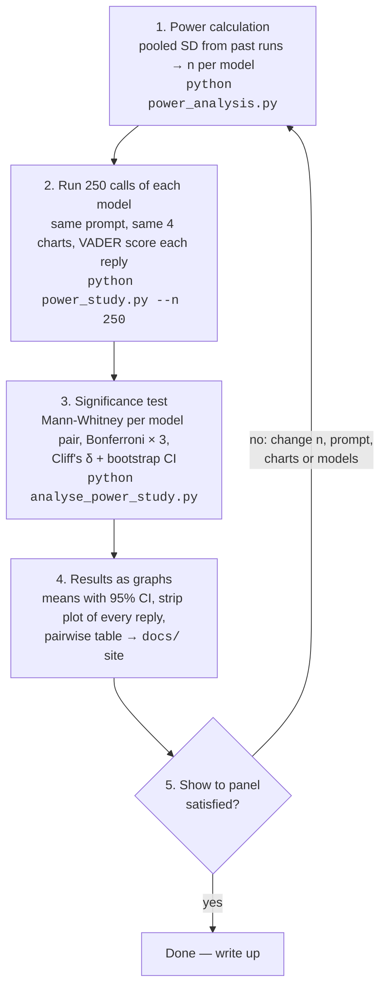

# Experiment 3 — Powered comparison of model sentiment (Δ = 0.10 VADER compound)

## Why

The two existing experiments were not powered. `run_analysis.py` uses n = 30 per
model and `controversial_snapshot.ipynb` uses n = 10 per model per topic. With the
observed within-cell SD of ~0.39, n = 10 can only reliably detect differences of
about 0.5 VADER units; a difference of 0.10 would be missed roughly 90% of the time.
This experiment fixes the sample size in advance so that a 0.10 difference in mean
compound score between any two models is detectable.

## Variance estimate (from existing data)

Source: `analysis/results/responses.csv` (4 topics × 3 models × 10 runs, `Interpret this plot.`,
temperature 1).

| Quantity | Value |
|---|---|
| Pooled within-cell SD | 0.391 (df = 108) |
| Per-cell SD range | 0.234 – 0.659 |
| Pooled SD, 30-run example plot | 0.275 (ceiling-inflated, see caveat) |
| Residual skew / excess kurtosis | −0.29 / 0.26 |

Regenerate with `python power_analysis.py`.

## Sample size

Two-sided, α = 0.05, Δ = 0.10, SD = 0.39, Mann-Whitney U (the test already used in
the repo). Analytic figures use the t-test formula divided by the Mann-Whitney
asymptotic relative efficiency of 0.955; simulation resamples the real residuals,
clips to [−1, 1], and runs Mann-Whitney directly.

| Target | n per model (analytic) | n per model (simulated) |
|---|---|---|
| 80% power, α = .05 | 252 | 200 |
| 80% power, α = .05/3 (Bonferroni, 3 pairs) | 336 | 250 |
| 90% power, α = .05 | 337 | 275 |
| 90% power, α = .05/3 | 433 | 300 |

The simulation is slightly more optimistic because the real residual distribution
is light-tailed and bounded. Plan on the analytic numbers and treat the simulation
as a lower bound.

**Decision: n = 300 per model per topic.** That gives ≥ 80% power for every
Bonferroni-corrected pairwise test and ~90% uncorrected, with headroom for the
higher-variance cells (Claude on Race & IQ had SD 0.66; at that SD, n = 300 gives
only ~50% power, which is the one cell this design knowingly under-serves).

Precision framing, for the write-up: n = 300 per group gives a 95% CI half-width
of about ±0.063 on each pairwise difference in means.

## Design

- **Topics:** the same four charts in `plots/` (CO2, COVID, Race & IQ, Gender pay gap).
  Keep all four so the result generalises beyond one image, but power is per topic.
- **Models:** current flagships, pinned: `claude-opus-5`, `gpt-5.5`, `grok-4.7` (chosen 2026-10-14 from each provider's model list). Pin exact model
  IDs and record them in the output. The repo currently mixes
  `claude-sonnet-4-20250514` (`run_analysis.py`) and `claude-sonnet-5`
  (`sway_stance.ipynb`); pick one and state it.
- **Prompt:** `Interpret this plot.`, unchanged. Default sampling for all three (Claude Opus 5 rejects `temperature`; GPT-5.x only accepts the default), max output 4096 tokens. Note: the variance estimate came from the previous generation (claude-sonnet-5 / gpt-4o / grok-4), so the pilot variance check matters more than usual.
- **Unit of observation:** one API call. Calls are independent draws at temperature 1,
  so n = 300 means 300 calls per model per topic.
- **Total calls:** 3 models × 4 topics × 300 = 3,600 (plus ~2% retry budget).
- **Pre-registered hypotheses:** for each topic, three pairwise two-sided
  Mann-Whitney tests (Claude–ChatGPT, Claude–Grok, ChatGPT–Grok) at α = 0.05/3.
  Report Cliff's delta (the `r` already computed in `significance_tests`) and a
  bootstrap 95% CI on the difference in means. Kruskal-Wallis is the omnibus
  gate, as now.
- **Secondary (exploratory):** pooled across topics with topic as a blocking
  factor; sentence-level VADER (see caveat); response length as a covariate.

## Caveats that affect what "0.10" means

1. **VADER saturates on long text.** Compound is a normalised sum of valence, so a
   long, mildly positive response is pushed toward +1. On the example plot Grok
   scored mean 0.985 with SD 0.010, which is a ceiling, not a stable opinion. A
   0.10 difference near 0 and a 0.10 difference near 0.9 are not the same thing.
   Mitigations: (a) also compute mean sentence-level compound per response and
   run the same tests on it; (b) report where each cell's mean sits before
   interpreting a pairwise difference; (c) prefer topics whose cell means sit in
   roughly [−0.6, 0.6], which all four controversial topics currently do.
2. **Heteroscedasticity.** Cell SDs span 0.23 – 0.66. Mann-Whitney is fine for
   location shift but the Bonferroni n above assumes SD ≈ 0.39 in both groups.
   Build in an **interim variance check** (below) rather than trusting the pilot.
3. **Bonferroni scope.** The snapshot corrected for 3 pairs within a topic but not
   across 4 topics (12 tests). Decide up front: per-topic family (α/3, as planned)
   with topics treated as replications, or one family of 12 (α/12, n ≈ 420).
   This plan uses per-topic families; state that explicitly in the write-up.
4. **Model drift.** 3,600 calls will span hours or days. Record timestamps and
   interleave models within each run loop (as `run_analysis.py` already does) so
   any drift affects all three models equally.

## Procedure

1. **Pilot / interim variance check (n = 50 per cell, 600 calls).**
   Re-estimate the pooled SD. If it is ≤ 0.42, continue to n = 300. If it is
   higher, recompute n with `power_analysis.py --delta 0.10` and update this file
   before continuing. Using an interim variance estimate without peeking at the
   effect does not inflate the type I error.
2. **Main run to n = 300 per cell.** Pilot observations count toward the total.
3. **Analysis** per the pre-registered tests above, then exploratory analyses.
4. **Report** means, SDs, CIs, Cliff's delta, and the ceiling diagnostic per cell.

## Implementation notes

New script `analysis_power/power_study.py` (do not modify `run_analysis.py`, whose
30-run output feeds the website):

- Reuse the three callers and `load_dotenv` from `run_analysis.py`.
- **Append-only CSV cache** keyed by (topic, model, run) so the job can be stopped
  and resumed; skip rows already present. Store `response`, `score`, `n_chars`,
  `finish_reason`, `model_id`, `timestamp_utc`.
- **Concurrency per provider** (a small thread pool, 3–4 workers per provider)
  with exponential backoff on 429/5xx. Sequential with a 0.5 s delay would take
  roughly 6–8 hours; concurrent should be under 2.
- Retry transient failures up to 3 times; log permanent failures as `None` and
  keep going. Target a final parse/success rate ≥ 98% and report it.
- Separate `analyse_power_study.py` (or a notebook with `RERUN = False`) that
  reads the cache and produces: per-topic descriptives, the pre-registered tests,
  bootstrap CIs, an error-bar plot with 95% CIs instead of ±1 SD, and the
  sentence-level VADER comparison.
- Add `power_analysis.py` output to the results folder as a record of the
  a-priori calculation.

## Cost and time

- Calls: ~3,700 including retries, each with one image (~1–2k input tokens) and
  ≤ 1024 output tokens.
- Rough spend at current list prices: $15–40 for Claude and GPT-4o combined,
  with Grok-4 likely the largest single line. Check xAI's current vision pricing
  before launch.
- Wall-clock: < 2 h with per-provider concurrency; one evening if run sequentially.

## Repo issues found during review (fix before reuse)

- `run_analysis.py`: `save_json` reads `tests["kruskal"]`, but
  `significance_tests` returns `H` and `p_kw`. The script will raise `KeyError`
  after all API calls complete and before the report prints. The committed
  `public/analysis/stats.json` must predate this change.
- `run_analysis.py`: `call_claude` hard-codes the model ID instead of using
  `MODELS["Claude"]`, so the `MODELS` table is misleading for Claude.
- `plot_errorbars` shows mean ± 1 SD; for a between-model comparison the error
  bars should be 95% CIs (or SE), otherwise overlap is uninformative.
- Model IDs differ across experiments (see Design). Pin and record them.
- `.env.local` is present in the working tree; confirm it is git-ignored
  (`.gitignore` exists, but verify it lists `.env.local`).

## Results site (GitHub Pages)

`docs/index.html` is a static d3 page (d3 from cdnjs, no build step) that reads
`docs/data/{descriptives.csv,scores.csv,tests.json,meta.json}`, which
`analyse_power_study.py` regenerates on every run. Enable it under
Settings -> Pages -> "Deploy from a branch" -> `main` / `/docs`. It shows means with
95% CIs per topic × model, a jittered strip of every response with a topic
selector, and the pairwise Mann-Whitney table. Rerun the analysis and commit
`docs/data/` to update the site.

## Run log

- 2026-10-14: smoke test passed for `claude-opus-5` and `grok-4.7`. `gpt-5.5`
  blocked: OpenAI account has no API credits (`credit_balance_exhausted`).
  Anthropic credits ran out partway through the pilot and were topped up; the
  pilot resumed from the cache. Pilot (n = 50/cell) running for Claude and Grok;
  ChatGPT cells to be filled once OpenAI credits are added
  (`python power_study.py --n 50 --models ChatGPT`).

## Flowchart

| Step | What happens | Output |
|---|---|---|
| 1. Power calculation | Take the SD of VADER scores from earlier runs, fix Δ = 0.10, α = 0.05, power 80%, solve for n. | n per model per chart |
| 2. Run 250 calls each | Ask each model "Interpret this plot." 250 times per chart, score every reply with VADER, cache to CSV. | `results/power_responses.csv` |
| 3. Significance test | For each chart compare the three models pairwise; report effect size and CI, not just p. | `results/power_tests.json` |
| 4. Results | Plot means with 95% CIs and the raw distribution; publish on the GitHub Pages site. | `docs/` |
| 5. Panel | Present, collect objections, change what they flag, loop back to step 1 until satisfied. | sign-off |
- 2026-10-14, pilot complete (Claude Opus 5 and Grok 4.7, 50 per cell, 0 Grok
  failures, 3 Claude failures from the credit gap, topped up afterwards).
  **Pooled within-cell SD = 0.537**, above the 0.42 threshold. The current
  flagships produce longer, more varied text than the previous generation the
  original 0.39 estimate came from. Consequences for Δ = 0.10:

  | n per cell | power at α/3 | power at α | min detectable Δ (80%, α/3) |
  |---|---|---|---|
  | 250 | 0.36 | 0.53 | 0.159 |
  | 300 | 0.43 | 0.61 | 0.145 |
  | 474 | 0.66 | 0.80 | 0.115 |
  | 633 | 0.80 | 0.90 | 0.100 |

  Decision pending with the panel: keep n = 250 and accept that only Δ ≈ 0.16 is
  detectable at α/3, or raise n to about 630 per cell (about 7,600 calls in
  total). Per-cell SDs range 0.24 (Grok, pay gap) to 0.70 (Claude, COVID), so the
  Claude cells are the binding constraint.
- The results page `docs/index.html` is now the live flowchart itself: each
  step box shows current numbers (SD and required n, collection progress per
  model, significant pairs, embedded means ± 95% CI chart) and its state
  (done / in progress / preliminary / not started) computed from the data.

- 2026-10-15, main run complete: Claude 1,000, Grok 1,000, ChatGPT 979 (21 calls
  lost to an OpenAI credit cut-off at the very end; cells at 244–245 instead of
  250, negligible power loss). Final pooled SD 0.521. Pre-registered tests at
  α/3: **11 of 12 pairwise comparisons significant**; sentence-level VADER
  (ceiling check) agrees on 9 of 12. Headline per chart (mean VADER compound):

  | Chart | Claude | ChatGPT | Grok | Non-significant pair |
  |---|---|---|---|---|
  | CO2 / Climate | +0.65 | +0.63 | +0.36 | — (Claude–ChatGPT sig by rank, means equal) |
  | COVID & masks | +0.24 | +0.09 | −0.34 | — |
  | Gender pay gap | +0.28 | +0.24 | +0.69 | Claude–ChatGPT |
  | Race & IQ | +0.32 | −0.13 | +0.18 | — |

  Ceiling diagnostic: Claude has the highest share of |score| > 0.9 (21–34% on
  three charts), consistent with its longer replies; interpret Claude's means with
  that in mind. Credits ran out three times during collection (Anthropic once,
  OpenAI twice, xAI once); the resumable cache made this harmless.
