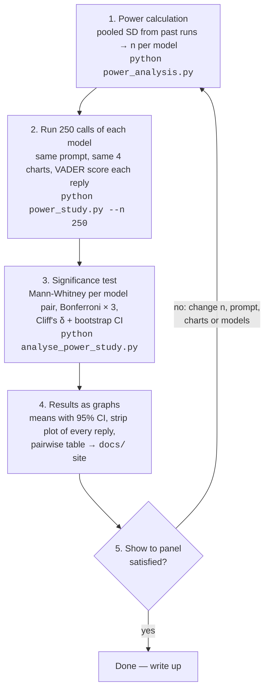

# Power experiment — steps

- Estimate variance: take the pooled within-cell SD of VADER compound from the existing runs (`analysis/results/responses.csv`) → SD ≈ 0.39.
- Fix the target: detect a difference of Δ = 0.10 in mean VADER compound between two models, two-sided α = 0.05, power 80%.
- Compute n per group: n = 2 · ((z₀.₉₇₅ + z₀.₈₀) · SD / Δ)² ≈ 2 · (2.8 · 0.39 / 0.10)² ≈ 240, then divide by 0.955 for Mann-Whitney → ≈ 252.
- Correct for 3 pairwise comparisons per topic (α = 0.05/3) → ≈ 336 per group; check with simulation (`python power_analysis.py`) which gives ≈ 250.
- Decide n = 300 runs per model per topic (3 models × 4 topics × 300 = 3,600 API calls).
- Run a pilot of 50 per cell, re-estimate the SD; if it exceeds 0.42, recompute n before continuing.
- Collect the remaining runs with the same prompt (`Interpret this plot.`), default sampling, pinned current models (`claude-opus-5`, `gpt-5.5`, `grok-4.7`), append-only CSV cache so the job can resume.
- Analyse: per topic, three pairwise Mann-Whitney tests at α/3, Cliff's delta, bootstrap 95% CI on the mean difference; plot means with 95% CIs.
- Check the VADER ceiling: flag any cell with mean > 0.9 and repeat the tests on mean sentence-level compound.
- Write up n, SD assumption, power, and all pre-registered tests before looking at results.

## Flowchart

| Step | What happens | Output |
|---|---|---|
| 1. Power calculation | Take the SD of VADER scores from earlier runs, fix Δ = 0.10, α = 0.05, power 80%, solve for n. | n per model per chart |
| 2. Run 250 calls each | Ask each model "Interpret this plot." 250 times per chart, score every reply with VADER, cache to CSV. | `results/power_responses.csv` |
| 3. Significance test | For each chart compare the three models pairwise; report effect size and CI, not just p. | `results/power_tests.json` |
| 4. Results | Plot means with 95% CIs and the raw distribution; publish on the GitHub Pages site. | `docs/` |
| 5. Panel | Present, collect objections, change what they flag, loop back to step 1 until satisfied. | sign-off |

## Why the target is 250 but the box says n ≈ 600

n = 2 · ((z₀.₉₇₅ + z₀.₈) · SD / Δ)² ÷ 0.955

- Earlier runs (previous model generation): SD = 0.39 → n = 2 · (2.80 · 0.39 / 0.10)² ÷ 0.955 ≈ **250**. That became the target.
- Pilot with current models: SD ≈ 0.52. Solving for Δ at n = 250: Δ = 2.80 · 0.52 · √(2/250) ÷ √0.955 ≈ **0.13** (≈ 0.16 with Bonferroni × 3).
- So 250 per cell detects a difference of about 0.13–0.16, not 0.10. That is fine: it is still a small effect on a −1…+1 scale, and the pilot's observed differences are several times larger. Raise n only if the panel insists on resolving 0.10.
